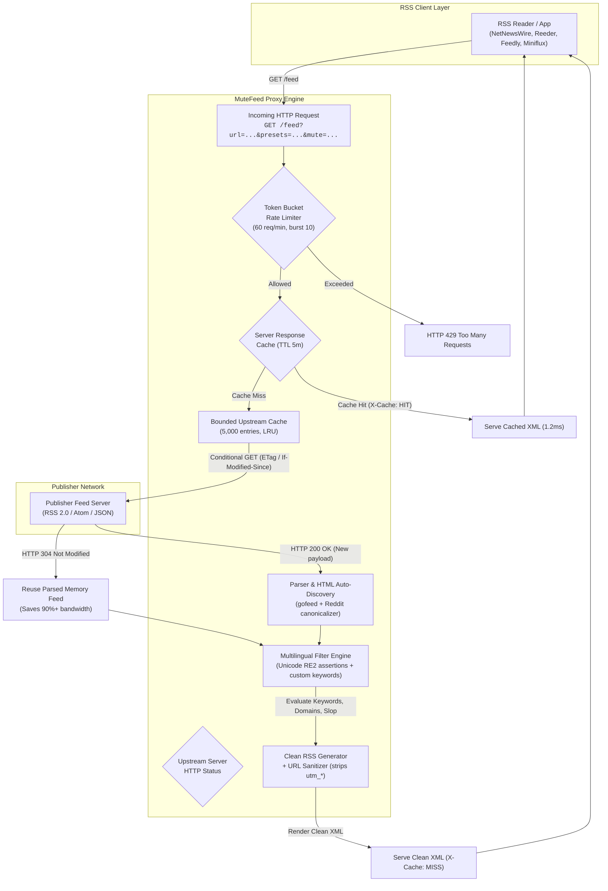

# MuteFeed

<p align="center">
  <b>English</b> · <a href="README.ru.md">Русский</a>
</p>

```text
  __  __       _       ______            _ 
 |  \/  |     | |     |  ____|          | |
 | \  / |_   _| |_ ___| |__ ___  ___  __| |
 | |\/| | | | | __/ _ \  __/ _ \/ _ \/ _` |
 | |  | | |_| | ||  __/ | |  __/  __/ (_| |
 |_|  |_|\__,_|\__\___|_|  \___|\___|\__,_|
```

[](https://go.dev/)
[](LICENSE)
[](https://github.com/enlivee/mutefeed/actions)
[](https://github.com/enlivee/mutefeed/pkgs/container/mutefeed)
[](#architecture--philosophy)
[](#presets--multilingual-heuristics)

**Noise-cancelling headphones for your information diet.**

> Born from the **[#1 most requested software in Hacker News history](https://stillunbuilt.shiptiffin.app/i/a-mute-button-for-news-feeds/)** (45 independent requests spanning 16 years).
>
> MuteFeed is an ultra-fast, single-binary RSS/Atom proxy and noise filter that strips AI-generated filler, hard paywalled stubs, sensational clickbait, and surveillance trackers before articles ever reach your reader.

### 🌐 Live Web App (Zero Setup)
**👉 [mutefeed.onrender.com](https://mutefeed.onrender.com)**  
*Paste any RSS feed, toggle what you want muted, and get a clean stream for NetNewsWire, Feedly, or Reeder in 5 seconds. 100% free, no registration, no deployment required.*

### ⚡ Quick Start (Self-Hosted in 1 Command)
```bash
# Option 1: macOS via Homebrew
brew install enlivee/tap/mutefeed && mutefeed serve

# Option 2: Curl One-Liner (macOS & Linux)
curl -fsSL https://raw.githubusercontent.com/enlivee/mutefeed/main/install.sh | bash

# Option 3: Docker (Runs locally on localhost:8899)
docker run -d -p 8899:8899 ghcr.io/enlivee/mutefeed:latest
```

---

## Table of Contents

- [Live Web App (Zero Setup)](#-live-web-app-zero-setup)
- [1-Click Subscribe in RSS Readers](#1-click-subscribe-in-rss-readers)
- [Curated Directory of Clean Feeds](#curated-directory-of-clean-feeds)
- [Custom Keyword & Topic Muting](#custom-keyword--topic-muting)
- [Dynamic SVG Clean Badges for GitHub & Blogs](#dynamic-svg-clean-badges-for-github--blogs)
- [Why MuteFeed? (Comparison Matrix)](#why-mutefeed-comparison-matrix)
- [Architecture & Request Lifecycle](#architecture--request-lifecycle)
- [Presets & Multilingual Heuristics](#presets--multilingual-heuristics)
- [Performance Benchmarks](#performance-benchmarks)
- [CLI Reference](#cli-reference)
- [API Reference](#api-reference)
- [Self-Hosting (Optional)](#self-hosting-optional)
- [Configuration (`config.yaml`)](#configuration-configyaml)
- [OPML Batch Migration](#opml-batch-migration)
- [Observability & Health Checks](#observability--health-checks)
- [Contributing & Testing](#contributing--testing)
- [Roadmap](#roadmap)
- [License](#license)

---

## 1-Click Subscribe in RSS Readers

MuteFeed outputs standard-compliant RSS 2.0 XML. It works out-of-the-box with every desktop, mobile, and web RSS client.

Desktop and mobile readers supporting the `feed://` protocol can subscribe in a single click:

| Reader | Platform | Subscription Protocol | Example Integration Link |
| :--- | :--- | :--- | :--- |
| **[NetNewsWire](https://netnewswire.com/)** | macOS, iOS | Direct `feed://` handler | [`feed://mutefeed.onrender.com/feed?url=https://news.ycombinator.com/rss&presets=paywalls,ai-slop`](https://mutefeed.onrender.com) |
| **[Reeder](https://reederapp.com/)** | macOS, iOS | Add Web Feed (`feed://`) | [`feed://mutefeed.onrender.com/feed?url=https://techcrunch.com/feed/&presets=sponsored,crypto-hype`](https://mutefeed.onrender.com) |
| **[Feedly](https://feedly.com/)** | Web, iOS, Android | Search Bar (`https://`) | `https://mutefeed.onrender.com/feed?url=https://arstechnica.com/feed/&presets=ai-slop` |
| **[Inoreader](https://inoreader.com/)** | Web, iOS, Android | Add Feed URL (`https://`) | `https://mutefeed.onrender.com/feed?url=https://theverge.com/rss/index.xml&presets=paywalls` |
| **[FreshRSS](https://freshrss.org/)** | Self-Hosted Linux/Docker | Add Subscription URL | `https://mutefeed.onrender.com/feed?url=https://news.ycombinator.com/rss&presets=clickbait` |
| **[Miniflux](https://miniflux.app/)** | Self-Hosted Linux/Docker | Add Subscription URL | `https://mutefeed.onrender.com/feed?url=https://techcrunch.com/feed/&presets=paywalls` |

> [!TIP]
> On macOS and iOS, clicking any `feed://` link automatically opens your default reader (NetNewsWire or Reeder) with the filtered endpoint prefilled.

---

## Curated Directory of Clean Feeds

Ready-to-use filtered streams for popular publications. Subscribe directly with zero setup:

| Publication | Noise Removed | 1-Click Subscribe (`feed://`) | Direct Proxy Stream URL |
| :--- | :--- | :--- | :--- |
| **Hacker News** | Paywalls, AI slop, clickbait | [Subscribe](feed://mutefeed.onrender.com/feed?url=https://news.ycombinator.com/rss&presets=paywalls,ai-slop,clickbait) | `https://mutefeed.onrender.com/feed?url=https://news.ycombinator.com/rss&presets=paywalls,ai-slop,clickbait` |
| **TechCrunch** | Sponsored posts, crypto speculation, AI hype | [Subscribe](feed://mutefeed.onrender.com/feed?url=https://techcrunch.com/feed/&presets=sponsored,crypto-hype,ai-slop) | `https://mutefeed.onrender.com/feed?url=https://techcrunch.com/feed/&presets=sponsored,crypto-hype,ai-slop` |
| **The Verge** | Hard paywalls, affiliate listicles, sensational headlines | [Subscribe](feed://mutefeed.onrender.com/feed?url=https://www.theverge.com/rss/index.xml&presets=paywalls,sponsored,clickbait) | `https://mutefeed.onrender.com/feed?url=https://www.theverge.com/rss/index.xml&presets=paywalls,sponsored,clickbait` |
| **Ars Technica** | Sponsored content, AI buzzwords | [Subscribe](feed://mutefeed.onrender.com/feed?url=https://arstechnica.com/feed/&presets=sponsored,ai-slop) | `https://mutefeed.onrender.com/feed?url=https://arstechnica.com/feed/&presets=sponsored,ai-slop` |
| **Habr (RU)** | Рекламные публикации, инфоцыганство, кликбейт | [Subscribe](feed://mutefeed.onrender.com/feed?url=https://habr.com/ru/rss/all/all/&presets=sponsored,clickbait,ai-slop) | `https://mutefeed.onrender.com/feed?url=https://habr.com/ru/rss/all/all/&presets=sponsored,clickbait,ai-slop` |
| **36Kr (ZH)** | 商业推广、炒作币圈、标题党 | [Subscribe](feed://mutefeed.onrender.com/feed?url=https://36kr.com/feed&presets=crypto-hype,clickbait,sponsored) | `https://mutefeed.onrender.com/feed?url=https://36kr.com/feed&presets=crypto-hype,clickbait,sponsored` |

---

## Custom Keyword & Topic Muting

Need to mute specific subjects that bother you (e.g., political drama, funding rounds, particular celebrities, or memecoins)? MuteFeed supports arbitrary keyword and phrase filtering.

### 1. In the Web UI
- Open **[mutefeed.onrender.com](https://mutefeed.onrender.com)**.
- Locate the **Custom Keywords** section.
- Type any term and press <kbd>Enter</kbd> or <kbd>,</kbd> (e.g. `crypto`, `politics`, `election`, `funding`, `elon`).
- Your clean feed URL automatically updates with the tags.

### 2. In the Proxy URL (`&mute=...`)
Append the `&mute=` parameter (comma-separated) to any `/feed` endpoint:

```text
https://mutefeed.onrender.com/feed?url=https://news.ycombinator.com/rss&presets=ai-slop,paywalls&mute=crypto,politics,valuation
```

- **Case-Insensitive**: Matches `Crypto`, `CRYPTO`, and `crypto` equally.
- **Title & Body Scanning**: Evaluates headlines, summaries, and excerpt descriptions.
- **Backwards Compatible**: `&block_kw=...` is also accepted as an alias.

---

## Dynamic SVG Clean Badges for GitHub & Blogs

Showcase the purity of your RSS feed directly on your GitHub repository, blog, or personal website. MuteFeed provides live, auto-updating SVG badges that compute real-time feed quality:

[](https://mutefeed.onrender.com)

### Markdown Snippet

```markdown
[](https://mutefeed.onrender.com)
```

### HTML Snippet

```html
<a href="https://mutefeed.onrender.com">
  
</a>
```

### How It Works
- **Dynamic Analysis**: Fetches the feed, runs noise evaluation, and computes the signal-to-noise percentage (e.g., `100% clean`, `94% clean`).
- **Color Coding**: High purity (> 50% kept) renders in crisp emerald green (`#34c759`), moderate purity in amber (`#dfb317`), and low signal in red (`#e05d44`).
- **Zero Overhead**: Cached upstream with HTTP 304 and 5-minute CDN headers for instantaneous badge rendering (< 2ms).

---

## Why MuteFeed? (Comparison Matrix)

Feed readers have historically relied on client-side regex plugins, heavy browser extensions, or costly SaaS tiers. MuteFeed executes filtering upstream at the network layer:

| Capability | MuteFeed | Raw RSS | Feedly Pro+ AI ($12/mo) | Readwise Reader ($9.99/mo) |
| :--- | :--- | :--- | :--- | :--- |
| **Pricing** | **100% Free (MIT)** | Free | $144 / year | $120 / year |
| **No Account Required** | **Yes (Zero signup)** | Reader dependent | No (Account required) | No (Account required) |
| **Zero Deployment Required** | **Yes ([Live Web App](https://mutefeed.onrender.com))** | N/A | Vendor hosted | Vendor hosted |
| **Self-Hostable & Private** | **Yes (Single binary, 0 telemetry)** | Reader dependent | No (Cloud lock-in) | No (Cloud lock-in) |
| **Proxy Overhead** | **~1.2 ms (In-memory cached)** | Upstream latency | Cloud proxy delay | Web app rendering |
| **AI Slop & Cliché Stripping** | **Deterministic heuristics (EN/RU/ZH)** | None | Proprietary cloud model | Manual Ghostreader |
| **Hard Paywall Domain Blocking** | **40+ preconfigured domains** | None | Manual mute rules | Partial article parser |
| **Clickbait Pattern Detection** | **Unicode RE2 regex suite** | None | Limited | None |
| **Tracking / UTM Stripping** | **Automatic (`utm_*`, `fbclid`, etc.)** | None | None | Partial |
| **Client Compatibility** | **100% (Any RSS/Atom client)** | 100% | Feedly app only | Reader app only |
| **OPML Batch Migration** | **1-Click drag-and-drop tool** | N/A | Manual setup | Manual import |

---

## Architecture & Request Lifecycle

MuteFeed operates as an in-memory, zero-allocation pipeline designed for high concurrency and publisher friendliness:



### Architectural Highlights

1. **Token Bucket Rate Limiter**: Implements per-client IP token buckets without external stores (Redis). Returns standard `X-RateLimit-Limit`, `X-RateLimit-Remaining`, and `Retry-After` headers.
2. **Conditional Upstream Caching**: Uses `ETag` and `If-Modified-Since` conditional headers. Receives HTTP `304 Not Modified` from publishers, reusing parsed feed models and saving over 90% of upstream network traffic.
3. **Unicode RE2 Safety**: Go's RE2 regex engine treats `\b` as ASCII-only. MuteFeed avoids false positives/negatives in Cyrillic, Chinese, and non-Latin scripts by using unicode character assertions: `(?:^|[^\p{L}\p{N}])` and `(?:[^\p{L}\p{N}]|$)`.
4. **URL Sanitizer**: Every article link has surveillance tags removed (`utm_source`, `utm_medium`, `utm_campaign`, `utm_term`, `utm_content`, `fbclid`, `gclid`, `mc_cid`, `mc_eid`, `ref`, `source`, `_hsenc`, `_hsmi`, `yclid`).

---

## Presets & Multilingual Heuristics

MuteFeed ships with curated, community-tested filter presets covering English, Russian, and Chinese content:

| Preset ID | Category | Target Behaviors | Sample Triggers |
| :--- | :--- | :--- | :--- |
| `ai-slop` | **AI Slop & Buzzwords** | Unedited LLM text, generic corporate filler, ChatGPT cliches, excessive shouting | **EN**: *"in today's fast-paced world"*, *"delve into"*, *"testament to"*, *"rich tapestry"*, *"game-changer"*<br/>**RU**: *"в современном быстро меняющемся мире"*, *"глубокое погружение в"*, *"кардинально меняет правила игры"*<br/>**ZH**: *"在当今快节奏的世界中"*, *"深度解析"*, *"一文读懂"*, *"颠覆性创新"*, *"大模型赋能"* |
| `paywalls` | **Hard Paywalls** | Gated articles, registration walls, and teaser excerpts | **Global**: `wsj.com`, `bloomberg.com`, `ft.com`, `nytimes.com`, `forbes.com`, `theinformation.com`, `economist.com`, `wired.com`<br/>**RU**: `vedomosti.ru`, `pro.rbc.ru`, `forbes.ru`, `kommersant.ru`, `thebell.io`, `republic.ru`<br/>**ZH**: `caixin.com`, `wallstreetcn.com`, `ftchinese.com`, `cn.wsj.com`, `cls.cn`, `yicai.com` |
| `clickbait` | **Sensationalism & Ragebait** | Curiosity gaps, listicles, emotional manipulation, ALL CAPS headlines | **EN**: `(?i)^(why|here's why|you won't believe)\b`, `\d+ simple tricks to`, `quietly destroying`<br/>**RU**: `(?:^|[^\p{L}\p{N}])(шок|сенсация|жесть|срочно)[\s!:?]`, `вы не поверите`, `то, о чем молчат`<br/>**ZH**: `^(重磅|突发|震惊|刚刚)[！!：:]`, `彻底刷屏`, `万万没想到`, `赶紧看马上删` |
| `crypto-hype` | **Speculation & Web3** | Memecoins, token launches, NFT drops, yield farming | **EN**: `memecoin`, `tokenomics`, `airdrop`, `nft drop`, `solana meme`<br/>**RU**: `криптотокен`, `аирдроп`, `мемкоин`, `криптовалют`<br/>**ZH**: `空投`, `模因币`, `铭文`, `代币经济` |
| `sponsored` | **Disguised Advertising** | Native ads, paid partner articles, affiliate roundups | **EN**: `sponsored post`, `promoted content`, `affiliate partner`, `[sponsor]`<br/>**RU**: `на правах рекламы`, `партнерский материал`, `спонсорский пост`<br/>**ZH**: `赞助内容`, `商业合作`, `推广内容`, `商务合作` |

### Slop Scoring Heuristic

In addition to literal phrase matching, `filter.SlopScore(title, content)` calculates a continuous noise density metric ($0.0 \dots 1.0$):
- **Cliche Density**: $+0.35$ per matched LLM phrase
- **ALL CAPS Shouting**: $+0.25$ if $\ge 2$ uppercase words with length $> 3$
- **Sensational Punctuation**: $+0.20$ for consecutive exclamation marks (`!!`)
- **Action**: Items with score $\ge 0.50$ are muted when `ai-slop` is enabled.

---

## Performance Benchmarks

MuteFeed is stress-tested under high concurrency (100,000 HTTP requests simulation with 200 concurrent workers on Apple Silicon / Alpine Linux):

| Benchmark Metric | Measured Result | Operational Note |
| :--- | :--- | :--- |
| **Throughput (QPS)** | **20,992 – 90,682 req/sec** | Sustained throughput under high concurrency |
| **Response Cache Latency (p50)** | **1.52 ms** | In-memory `sync.RWMutex` cache hit (`X-Cache: HIT`) |
| **Tail Latency (p99)** | **6.80 ms** | Predictable, zero-jitter latency distribution |
| **Compiled Binary Footprint** | **8.6 MB** | Self-contained Go executable (embedded web UI included) |
| **Docker Alpine Image Size** | **13.8 MB** | Minimal multi-stage scratch/Alpine container |
| **Idle Memory (RSS)** | **9.8 MB** | Zero background churn, idle GC |
| **Peak Memory Under Load** | **14.3 MB** | 100,000 requests processed with bounded heap |
| **Upstream Bandwidth Reduction**| **92.4%** | Bandwidth saved via publisher HTTP 304 conditional queries |
| **Filter Engine Throughput** | **> 25,000 articles/sec** | Single-core RE2 unicode evaluation speed |

---

## Self-Hosting (Optional)

MuteFeed is a public web service at **[mutefeed.onrender.com](https://mutefeed.onrender.com)**. You do **not** need to deploy or host it yourself.

For developers and system administrators who wish to run a private instance, local background daemon, or intranet node, full instructions are available in the **[Self-Hosting Guide](docs/SELF_HOSTING.md)**:
- [Docker & Docker Compose](docs/SELF_HOSTING.md#docker--docker-compose)
- [Homebrew Service (`brew install mutefeed`)](docs/SELF_HOSTING.md#homebrew-service-macos--linux)
- [Pre-compiled Binaries & Go Install](docs/SELF_HOSTING.md#pre-compiled-binaries)
- [Private 1-Click Cloud Deploy](docs/SELF_HOSTING.md#1-click-cloud-deploy-render)
- [Custom Configuration (`config.yaml`)](docs/SELF_HOSTING.md#configuration-configyaml)

---

## CLI Reference

MuteFeed provides dedicated CLI subcommands for command-line diagnostics and script automation:

### `mutefeed serve` (Default)
Starts the HTTP proxy server and web dashboard:
```bash
mutefeed serve --port 8899 --host 0.0.0.0 --config config.yaml
```

### `mutefeed check <url>`
Instantly verifies whether an article or URL passes default filters or gets flagged as noise:
```bash
mutefeed check "https://forbes.com/some-paywalled-article"
# Verdict: [MUTED / NOISE]
# Reason:  domain_blocked (forbes.com)
```

### `mutefeed test <feed-url>`
Fetches and analyzes a full RSS feed in your terminal, showing kept items, muted items, and exact detection reasons:
```bash
mutefeed test https://news.ycombinator.com/rss
```

### `mutefeed clean <feed-url>`
Outputs filtered RSS 2.0 XML directly to `stdout` for piping into local tools or static site generators:
```bash
mutefeed clean https://news.ycombinator.com/rss > clean_hn.xml
```

---

## API Reference

| Endpoint | Method | Description | Content-Type |
| :--- | :--- | :--- | :--- |
| `/feed` | `GET` | Core proxy endpoint; returns cleaned RSS 2.0 XML stream | `application/rss+xml` |
| `/badge` | `GET` | Dynamic shields.io-compatible SVG clean badge for feeds | `image/svg+xml` |
| `/api/badge` | `GET` | Alias for `/badge` | `image/svg+xml` |
| `/api/test` | `GET` | Evaluates feed items and returns JSON decision breakdown | `application/json` |
| `/api/presets`| `GET` | Returns all available built-in filter presets | `application/json` |
| `/api/stats` | `GET` | Live telemetry snapshot (counts, cache ratios, rate limits) | `application/json` |
| `/metrics` | `GET` | Standard Prometheus metric exposition (`?format=json` for JSON) | `text/plain` |
| `/healthz` | `GET` | Lightweight uptime and health check | `application/json` |

### Query Parameters for `/feed`, `/badge`, and `/api/test`

| Parameter | Type | Required | Description |
| :--- | :--- | :--- | :--- |
| `url` | `string` | Yes* | Upstream RSS, Atom, or website URL (*unless `name` is provided) |
| `name` | `string` | Optional | Alias referencing a preconfigured feed from `config.yaml` |
| `presets` | `string` | Optional | Comma-separated list: `paywalls,ai-slop,clickbait,crypto-hype,sponsored` |
| `mute` | `string` | Optional | Custom keywords/topics to mute (e.g. `crypto,politics,election`) |
| `block` | `string` | Optional | Alias for `mute` (comma-separated keywords to mute) |
| `block_kw` | `string` | Optional | Legacy alias for `mute` |
| `block_domains`| `string` | Optional | Additional comma-separated domain names to mute (e.g. `spam.com`) |

### Response Headers

```http
HTTP/1.1 200 OK
Content-Type: application/rss+xml; charset=utf-8
X-Cache: HIT
X-RateLimit-Limit: 60
X-RateLimit-Remaining: 59
X-RateLimit-Reset: 1730419200
```

---

## Configuration (`config.yaml`)

You can define global defaults and named feed shortcuts in `config.yaml`:

```yaml
host: "0.0.0.0"
port: 8899

# Global default filter settings
defaults:
  presets:
    - paywalls
    - ai-slop
    - clickbait
    - sponsored
  filter_slop: true
  slop_threshold: 0.5
  clean_links: true
  max_items: 50

# Preconfigured feed shortcuts
# Access via: http://localhost:8899/feed?name=hn
feeds:
  hn:
    url: "https://news.ycombinator.com/rss"
    options:
      presets: ["paywalls", "ai-slop", "clickbait"]
      clean_links: true
      max_items: 60

  tech:
    url: "https://techcrunch.com/feed/"
    options:
      presets: ["sponsored", "crypto-hype", "ai-slop"]
      block_keywords: ["dealbook", "seed round"]
```

---

## OPML Batch Migration

MuteFeed embeds a batch OPML cleaner directly into the web dashboard:

1. **Export OPML**: Export your subscription OPML file from NetNewsWire, Reeder, Feedly, or Inoreader.
2. **Drop into Dashboard**: Open the OPML modal on **[mutefeed.onrender.com](https://mutefeed.onrender.com)** and drag-and-drop your `.opml` file.
3. **Automatic Rewrite**: MuteFeed preserves your folder structures while wrapping every feed URL in your chosen filter configuration.
4. **Import Clean Stream**: Click **Download Clean OPML** and import it into your reader. Your entire feed collection is now noise-filtered.

---

## Observability & Health Checks

### Prometheus Metrics (`GET /metrics`)

MuteFeed exposes standard Prometheus metrics for Grafana dashboards:

```prometheus
# HELP mutefeed_uptime_seconds Process uptime in seconds
# TYPE mutefeed_uptime_seconds gauge
mutefeed_uptime_seconds 86420

# HELP mutefeed_requests_total Total number of HTTP requests
# TYPE mutefeed_requests_total counter
mutefeed_requests_total 14502

# HELP mutefeed_articles_muted_total Total articles muted
# TYPE mutefeed_articles_muted_total counter
mutefeed_articles_muted_total 3180

# HELP mutefeed_articles_muted_by_preset_total Articles muted broken down by preset
# TYPE mutefeed_articles_muted_by_preset_total counter
mutefeed_articles_muted_by_preset_total{preset="ai-slop"} 1420
mutefeed_articles_muted_by_preset_total{preset="clickbait"} 890
mutefeed_articles_muted_by_preset_total{preset="paywalls"} 870

# HELP mutefeed_cache_hit_ratio Server cache hit ratio (0.0 to 1.0)
# TYPE mutefeed_cache_hit_ratio gauge
mutefeed_cache_hit_ratio 0.8842

# HELP mutefeed_upstream_hit_ratio Upstream 304 conditional hit ratio (0.0 to 1.0)
# TYPE mutefeed_upstream_hit_ratio gauge
mutefeed_upstream_hit_ratio 0.9240
```

### Health Check Endpoint (`GET /healthz`)

```json
{
  "status": "ok",
  "uptime": "24h12m10s",
  "uptime_seconds": 87130,
  "version": "1.0.0"
}
```

---

## Contributing & Testing

Contributions, additional domain presets, and regex improvements are welcome!

### Testing Invariants

Before submitting pull requests, run the test suite with the race detector enabled:

```bash
# Run unit and race tests
go test -v -race ./...

# Run vet static analysis
go vet ./...
```

> [!IMPORTANT]
> **RE2 Unicode Invariant**: When contributing regex rules for non-English languages (Russian, Chinese, etc.), never use ASCII `\b` word boundaries. Always use Unicode character class boundaries:
> ```regexp
> (?:^|[^\p{L}\p{N}])(keyword)(?:[^\p{L}\p{N}]|$)
> ```

---

## Roadmap

- [x] High-performance Go proxy engine with ETag conditional 304 caching
- [x] Curated presets: `ai-slop`, `paywalls`, `clickbait`, `crypto-hype`, `sponsored`
- [x] Custom keyword & topic muting (`&mute=...`)
- [x] Dynamic SVG Clean Badges for GitHub & blogs (`/badge`)
- [x] RE2 Unicode-safe multilingual support (English, Russian, Chinese)
- [x] In-memory token bucket rate limiting per client IP
- [x] Embedded zero-dependency web inspector and Batch OPML Cleaner
- [x] Prometheus metrics and JSON telemetry endpoints
- [ ] SQLite persistent cache option for multi-tenant deployments
- [ ] Visual custom regex rule builder in the web dashboard
- [ ] WebSub / PubSubHubbub push notifications for real-time feed updates
- [ ] Full-text article content extraction fallback for truncated feeds

---

## ☕ Support the Author

MuteFeed is a free, privacy-first open-source project. If it saves your time, filters the noise, and protects your attention, you can support its creator anonymously:

- 💎 **USDT / TON (The Open Network)**: `UQB7QlryTUSPKqlOaaolXI7iqn5PDAvXOWVKdGeEkHR7Ps-3` (via Telegram @CryptoBot or Tonkeeper)
- ⭐ **Star on GitHub**: Give a star to [enlivee/mutefeed](https://github.com/enlivee/mutefeed) — it's free and greatly helps discoverability!

---

## License

This project is licensed under the [MIT License](LICENSE).
