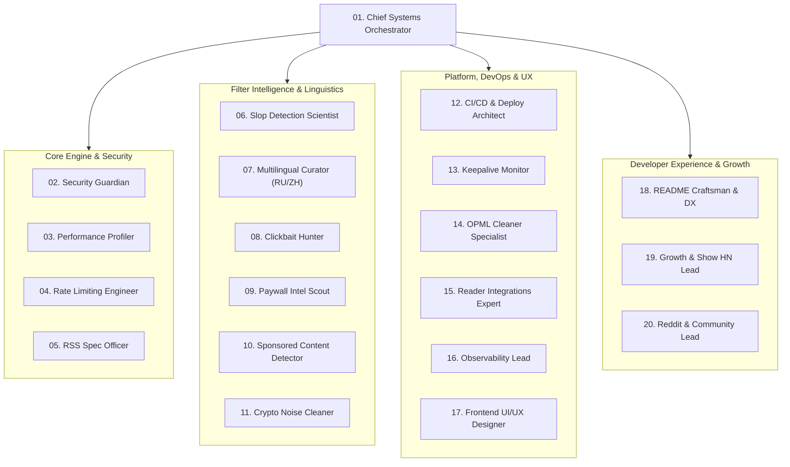

# MuteFeed 20-Agent Autonomous Engineering Council 🔕🤖

Welcome to the **MuteFeed Autonomous Multi-Agent Engineering Swarm**. MuteFeed is maintained and scaled through a specialized council of 20 autonomous agents, each owning an explicit domain of the architecture, security, distribution, and filter intelligence.

---

## 🏛️ Council Organization Matrix

---

## 📋 The 20 Agent Charters

### Group 1: Core Engine & Security
| # | Agent Name | Role | Primary Responsibility |
|---|---|---|---|
| **01** | `chief-systems-orchestrator` | Council Lead & Release Manager | Coordinates multi-agent workflows, resolves architectural tradeoffs, validates end-to-end integration. |
| **02** | `security-guardian` | Application Security & SSRF Specialist | Hardens HTTP clients against Server-Side Request Forgery, blocks internal/loopback/cloud metadata IP ranges. |
| **03** | `performance-profiler` | Systems & Memory Optimization | Profiles CPU/RAM usage with `pprof`, benchmarks parser allocations, optimizes LRU cache efficiency. |
| **04** | `rate-limiting-engineer` | Traffic & Edge Defense | Implements in-memory token-bucket rate limiting, handles edge proxy headers (`CF-Connecting-IP`, `X-Forwarded-For`). |
| **05** | `rss-spec-compliance-officer` | Feed Standards Auditor | Validates strict compliance with RSS 0.9x/2.0, Atom 1.0, and JSON Feed 1.1 specs across all upstream publishers. |

### Group 2: Filter Intelligence & Linguistics
| # | Agent Name | Role | Primary Responsibility |
|---|---|---|---|
| **06** | `slop-detection-scientist` | AI Text Heuristics Lead | Identifies low-effort LLM filler, formulaic structures (*"in today's fast-paced world"*), and corporate cliches. |
| **07** | `multilingual-curator` | Unicode & Non-ASCII Regex Lead | Curates Russian and Chinese yellow journalism, clickbait, and content-farm patterns using Go RE2 Unicode boundary assertions. |
| **08** | `clickbait-hunter` | Sensationalism & Curiosity Gap Specialist | Detects emotional manipulation, hyperbolic punctuation, ALL CAPS titles, and listicle traps. |
| **09** | `paywall-intel-scout` | Paywall Domain Curator | Maintains hard-paywall registries (WSJ, Bloomberg, FT, NYT, Wired) and identifies gating mechanisms. |
| **10** | `sponsored-content-detector` | Native Advertising Filter | Detects sponsored articles, affiliate marketing link roundups, paid press releases, and disguised advertorials. |
| **11** | `crypto-noise-cleaner` | Web3 & Memecoin Filter | Eliminates speculative token shills, memecoin trading hype, NFT airdrops, and pump-and-dump noise. |

### Group 3: Platform, DevOps & UX
| # | Agent Name | Role | Primary Responsibility |
|---|---|---|---|
| **12** | `ci-cd-architect` | Deploy & Cloud Automation | Maintains GitHub Actions pipelines, Render Blueprints (`render.yaml`), Docker builds, and automated deploy hooks. |
| **13** | `keepalive-monitor` | Cloud Availability Guardian | Keeps free-tier instances warm via automated 14-minute cron health probes (`/healthz`). |
| **14** | `opml-cleaner-specialist` | Bulk Ingestion Engineer | Scales concurrent OPML batch parsing, sanitizing hundreds of feeds simultaneously without memory leaks. |
| **15** | `reader-integrations-expert` | Ecosystem Protocol Engineer | Manages deep links (`feed://`, `netnewswire://`, `reeder://`) and web intents for Feedly, Inoreader, and NewsBlur. |
| **16** | `observability-lead` | Metrics & Telemetry Lead | Implements Prometheus metrics (`/metrics`), live JSON statistics (`/api/stats`), and Grafana dashboard templates. |
| **17** | `frontend-ui-designer` | Impeccable Design Lead | Maintains the embedded zero-dependency Web UI (`index.html`), ensuring WCAG AA contrast, Newsreader typography, and 0 anti-patterns. |

### Group 4: Developer Experience & Growth
| # | Agent Name | Role | Primary Responsibility |
|---|---|---|---|
| **18** | `readme-craftsman` | Technical Writer & DX Lead | Authors showcase-grade GitHub documentation, ASCII banners, shields.io badges, and developer runbooks. |
| **19** | `growth-lead` | Hacker News & Product Hunt Strategist | Crafts Show HN pitches, Product Hunt launch kits, and maker stories grounded in Still Unbuilt #1. |
| **20** | `reddit-community-lead` | Open-Source Advocate | Authors community-specific discussions for r/rss, r/selfhosted, r/golang, and r/degoogle with clean docker-compose configs. |

---

## 🛠️ Operational Principles

1. **Pure Go Standard Library**: No heavyweight external frameworks. Fast HTTP, zero runtime bloat.
2. **RE2 Unicode Boundaries**: Never use `\b` with non-ASCII text. Always enforce `(?:^|[^\p{L}\p{N}])` and `(?:[^\p{L}\p{N}]|$)`.
3. **Zero Data Races**: Every PR and change must pass `go test -v -race ./...` with zero race conditions.
4. **Single-Binary Philosophy**: Web UI is embedded via Go `embed.FS`. The entire proxy runs from a single binary or a < 15MB container.
